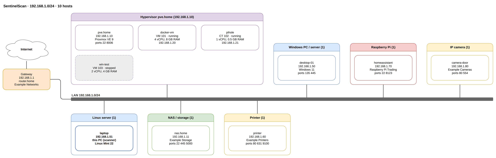

# Network drawings

After a network scan, **Network drawing** (on the Scan page when the scan
finishes, and on every saved network scan in History) draws what the scan found.



The picture above comes from made-up example data, not a real network:
`examples/example-findings.json` (a scan result), `examples/example-network.drawio`
(open it in draw.io or on diagrams.net), `images/network-drawing.svg` (the dashboard
preview) and `images/network-drawing.png` (draw.io CLI export). To make them again
after changing `panel/diagrams.py`:

```bash
python3 -c "import json,sys; sys.path.insert(0,'panel'); import diagrams as D
d=json.load(open('docs/examples/example-findings.json'))
open('docs/examples/example-network.drawio','w').write(D.drawio(d))
open('docs/images/network-drawing.svg','w').write(D.svg(d))
open('docs/images/network-drawing.png','wb').write(D.export(d,'png'))"   # PNG needs draw.io desktop
```

## What is drawn

Page 1, **Network**: the internet, the gateway, the local network line and every
host, grouped by device type (hypervisor, Linux server, NAS, Raspberry Pi,
printer, ...; "Other / unidentified" last). Each box shows the name or IP, the
IP, the OS or maker, and open ports. This PC (the scanner) has a bold border.
A hypervisor whose VMs were listed (Proxmox card or SSH login) holds its VMs;
stopped VMs are dashed. A VM that was also seen on the network appears only
inside its hypervisor.

Page 2, **Virtual machines** (when the scan listed any): each hypervisor with
its VMs and containers, vCPUs, memory, disks (size, NVMe/SSD/HDD) and guest OS.

In draw.io, hover a box for its full details (ports with versions, apps, MAC).

## Formats

| Button | What you get | Needs |
|---|---|---|
| Preview | the drawing in the dialog (SVG) | nothing |
| Download for draw.io | `.drawio` file, every box editable | nothing; open it in [draw.io desktop](https://github.com/jgraph/drawio-desktop/releases) (free) or on diagrams.net |
| PNG image | picture of page 1 | nothing (made in the browser); with draw.io desktop installed: all of page 1 at 2x through its CLI |
| PDF | all pages | draw.io desktop on this machine (`xvfb` too when the panel runs as a service without a display) |
| Open in diagrams.net | the drawing in the diagrams.net editor | internet; the drawing is inside the link after `#`, which browsers don't send to the server |

## Getting draw.io desktop (for PDF)

`./install.sh --drawio` downloads the latest official `.deb` from
github.com/jgraph/drawio-desktop/releases, checks it against the
`Files-SHA256-Hashes.txt` published with that release, and installs it with
`xvfb` (needed when the panel runs as a service without a screen). Without it
everything except PDF still works.

## Why not the drawio-skill

The drawio-skill (Agents365-ai/drawio-skill) is a set of instructions for an AI
assistant: it tells Claude how to write draw.io XML and export it with the
draw.io CLI. It can't run inside the dashboard for its users. The panel does
the same thing directly: `panel/diagrams.py` writes the same open `.drawio`
format and uses the same draw.io desktop CLI for PNG/PDF when it is there.

## How it works

`panel/diagrams.py` reads the scan's `findings.json` (found through the
scan's `report_path` in the database, only inside `discovery/reports/`),
computes one layout (boxes and lines with coordinates) and writes it twice: as
draw.io XML and as SVG. Labels are plain text (`html=0`) and XML-escaped,
because host names, vendors and app names come from the network.

API (GET): `/api/diagram/<scan>/drawio|svg|png|pdf|link`, `/api/diagram/tools`.
Downloads are noted in the activity log (`scan.diagram`).
